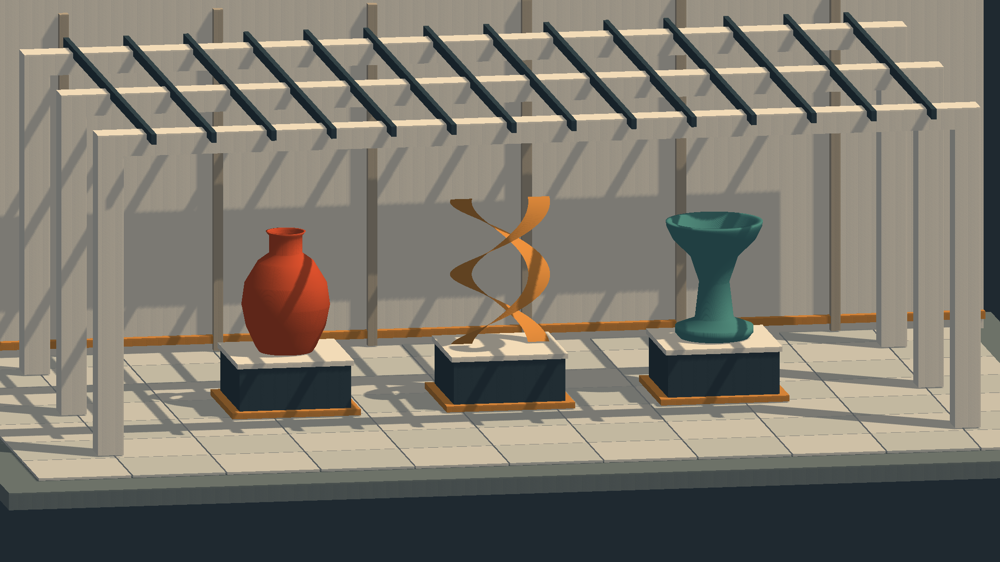
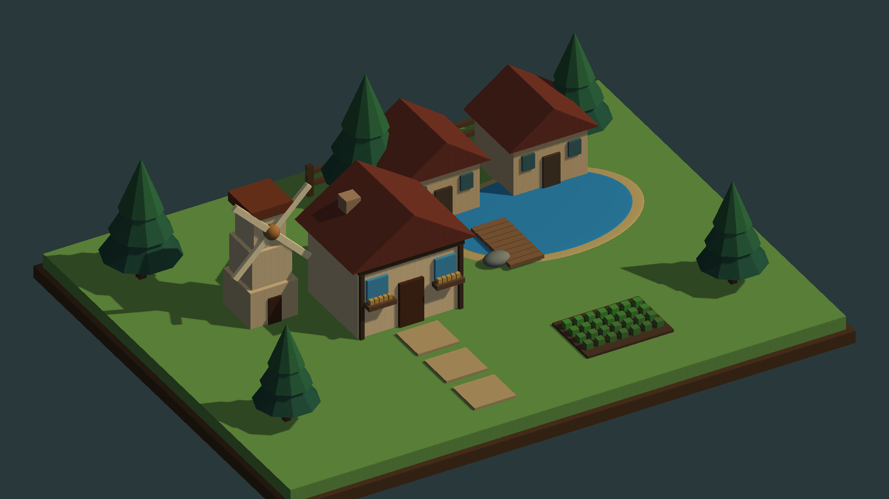
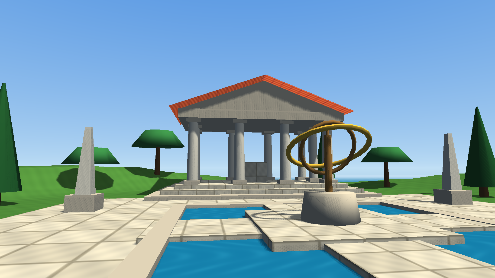
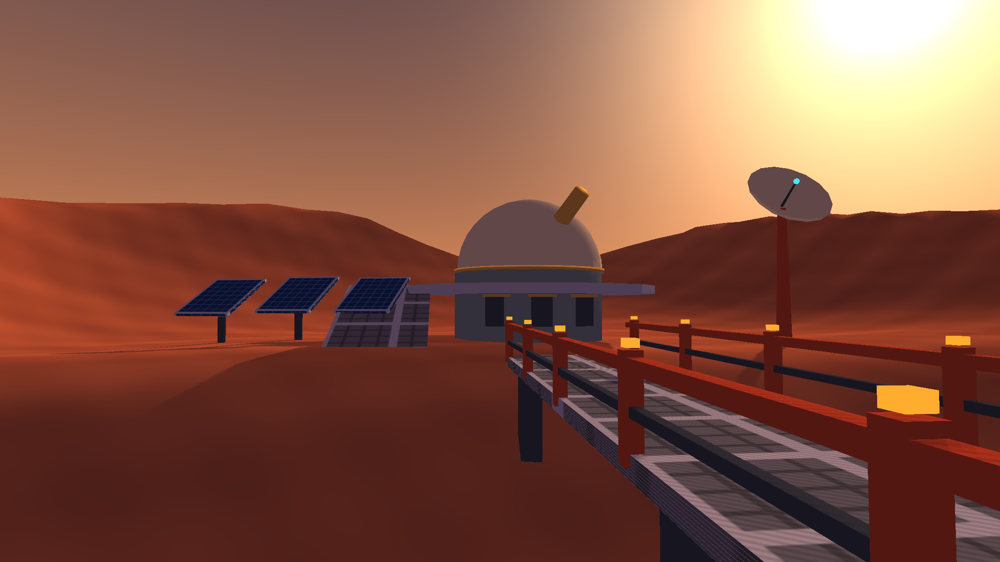

# Huynity Engine

Huynity — C++23-движок с аппаратным рендерингом на OpenGL 3.3 Core (`GlRenderer`) и собственным программным растеризатором (`SoftwareRenderer`) как эталонным headless/fallback-бэкендом, геометрической библиотекой и оконным адаптером. Программный рендерер написан вручную на чистом C++23: алгоритмы проекции, отсечения, затенения, растеризации и фильтрации текстур не зависят от графических API и используются для детерминированных побайтовых проверок и сред без GPU.

---

## Возможности

- **3D и 2D в одном кадре:** многослойная композиция `World3DPass`, `World2DPass` и экранного `Hud2DPass`.
- **Рукописные алгоритмы рендеринга:**
  - Целочисленный алгоритм Брезенхэма для 2D/3D линий с Z-буфером;
  - Проволочный каркасный режим (`wireframe`);
  - Гладкое вершинное затенение Гуро (`Gouraud Shading`) с кешированием нормалей;
  - Софтверное текстурирование с выборкой (Nearest Neighbor, Bilinear) и альфа-прозрачностью (source-over).
- **Сцена и память Core:** поколенческие `ObjectId`, плотное хранение, иерархия трансформаций, кеширование bounds и тесселяции геометрии.
- **Игровой цикл Runtime:** симуляция с фиксированным тиком (60 Гц), конвейер кадра `FramePipeline` (глубина 1+1, монотонные поколения поверхности, защита от stale-кадров) и пул буферов `FramebufferPool`.
- **Высокоуровневый Engine API:** запуск законченной игры менее чем за 25 строк C++23 кода.
- **Оконная подсистема:** нативное системное окно SDL3 с поддержкой HiDPI и детерминированный `HeadlessWindow` для CI и тестов.

---

## Быстрый старт через Docker (Любая ОС: Windows, macOS, Linux)

Движок и интерактивные примеры можно запустить в любой ОС в одну команду через встроенный HTML5 noVNC веб-клиент:

```bash
# 1. Запуск интерактивной 3D-арены в контейнере:
docker compose up

# 2. Откройте в любом браузере:
# 👉 http://localhost:6080
```

Подробнее см. в [Руководстве по Docker](docs/docker_guide.md).

---

## Локальная сборка из исходников

### Требования
- Компилятор C++23 (GCC 14+, Clang 18+)
- CMake 3.20+
- Ninja
- Заголовки и библиотека OpenGL (`mesa-libGL-devel` на Fedora, `libgl1-mesa-dev` на Ubuntu)
- *(Опционально)* `SDL3-devel` для нативного системного окна (при отсутствии автоматически используется HeadlessWindow)

### Сборка и тесты
```bash
# Сборка проекта
HUYNITY_BUILD_ADAPTERS=ON ./tools/scripts/build.sh

# Запуск полного набора из 53 тестов CTest:
ctest --test-dir build --output-on-failure

# Запуск интерактивных примеров:
./build/examples/hello_cube/huynity_hello_cube --continuous
./build/examples/sunlit_sanctuary/huynity_sunlit_sanctuary --continuous
./build/examples/canyon_observatory/huynity_canyon_observatory --continuous
./build/examples/game_scene/huynity_game_scene --continuous
./build/examples/renderer_gallery/huynity_renderer_gallery --continuous
```

---

## Документация

- [Как работает движок: простое описание и архитектурная схема](docs/how_engine_works.md)

- [Архитектура и взаимодействие подсистем](docs/subsystem_interaction.md)
- [Высокоуровневый Engine API](docs/engine_api.md)
- [Оконный адаптер и подсистема ввода](docs/window_adapter.md)
- [Запуск в Docker-контейнере](docs/docker_guide.md)
- [Нагрузочные сценарии и Baseline производительности](docs/benchmarks.md)
- [Сводный отчёт верификации](docs/verification.md)
- [Правила разработки и конвенции](AGENTS.md)

## Примеры для презентации

`hello_cube` сохраняет демонстрацию базовых возможностей. Остальные сцены показывают законченные композиции:

- `renderer_gallery` — зал **Forms in Light** с керамикой, бронзовой скульптурой и открытой колоннадой.
- `game_scene` — изометрическая деревня с мельницей, причалом, огородом и елями.
- `sunlit_sanctuary` — мраморный двор с бассейном, механической астролябией и античным храмом.
- `canyon_observatory` — обсерватория с мостом и солнечными панелями в закатном каньоне.
- `window_demo` — кинетический экспонат на низкоуровневом конвейере Runtime и оконного адаптера.

Запуск: `./build/examples/renderer_gallery/huynity_renderer_gallery --continuous`.
У галереи A/D поворачивают камеру, колесо мыши меняет масштаб. Управление остальными сценами выводится при запуске.

Кадр без игрового HUD: `./build/examples/sunlit_sanctuary/huynity_sunlit_sanctuary --screenshot /tmp/sanctuary.ppm`.
Ключ `--screenshot` поддерживают все пять сцен; формат файла — PPM (P6).
Четыре сцены на Engine используют OpenGL при доступном окне, иначе — программный рендерер.
`window_demo` демонстрирует программный конвейер. Обычный запуск без аргументов завершает короткий проверочный прогон.







В святилище и обсерватории обзор работает движением мыши или тачпада без зажатой кнопки, одновременно с WASD.
В GNOME для одновременной работы тачпада и клавиатуры нужно отключить блокировку при печати:
`gsettings set org.gnome.desktop.peripherals.touchpad disable-while-typing false`.
Эта настройка действует во всей системе. Вернуть блокировку можно той же командой со значением `true`.
