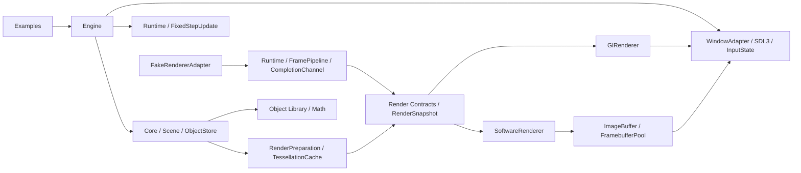

# Аудит Huynity

Исходная ревизия `1c2b89e` на Fedora 43 x86-64. Аудит архитектуры C++, анализ CPU и аудит OpenGL выполнены параллельно тремя агентами. Реализацию изменений выполняет отдельный агент. Проверки диффов проводят агенты, которые их не писали.

## Карта исполнения

| Подсистема | Реализация и владение |
|---|---|
| Цикл приложения | Примеры вызывают фасад `Engine`. `step` опрашивает ввод, продвигает fixed-step, собирает кадр и синхронно отправляет его в бэкенд. `run` ограничивает частоту, SDL отдельно запрашивает swap interval. [Engine](../engine/core/src/engine.cpp) |
| Сцена | Плотные массивы с идентификаторами и поколениями, иерархия, dirty-флаги и мировые AABB. `SceneView` отдаёт владеющий снимок в публичный API. Самостоятельной ECS нет. [Scene](../engine/core/include/huynity/core/scene.h) · [ObjectStore](../engine/core/include/huynity/core/object_store.h) |
| Геометрия и физика | Object Library проверяет инварианты примитивов, строит меши и AABB. Использование AABB для видимости относится к извлечению кадра. Физического движка и системы столкновений игровых сущностей нет. [Object Library](objectlib_usage.md) |
| Ресурсы | Снимок владеет ссылками на геометрию и материалы. Core тесселирует и дедуплицирует меши, GL хранит GPU-ресурсы по ключу и версии, CPU кеширует данные шейдинга. Централизованного загрузчика ассетов нет. [Render Contracts](../engine/render_contracts/include/huynity/render_contracts/render_snapshot.h) |
| Графика | OpenGL 3.3 Core использует встроенные GLSL-программы для World3D, screen-space, неба и теней. SoftwareRenderer отрисовывает World3D, World2D и HUD в CPU RGBA8. Материалы и трансформации задаёт снимок. [GlRenderer](../engine/renderer/src/gl_renderer.cpp) · [SoftwareRenderer](../engine/renderer/src/software_renderer.cpp) |
| Память кадра | `ImageBuffer` владеет байтами. Пул переиспользует буфер показа, GL в обычном пути рисует напрямую. `capture` выделяет буфер и читает GPU синхронно по запросу. [FramebufferPool](../engine/runtime/include/huynity/runtime/framebuffer_pool.h) |
| Ввод и представление | SDL3 владеет окном, GL-контекстом, событием resize и swap. HeadlessWindow принимает готовое CPU-изображение. [NativeWindow](../adapters/window/src/native_window.cpp) |
| Параллелизм | Runtime содержит модель backpressure 1+1, поколения framebuffer и тестовый FakeRendererAdapter. Текущий фасад рендерит синхронно. `CompletionChannel` хранит обычные флаги и `optional`. Реальному межпоточному транспорту нужна синхронизация. Планировщика задач нет. [FramePipeline](../engine/runtime/include/huynity/runtime/frame_pipeline.h) · [CompletionChannel](../engine/runtime/include/huynity/runtime/frame_completions.h) |

## Приоритеты и доказательства

| Приоритет | Находка | Решение и проверка |
|---|---|---|
| P0 / исправлено | До исправления SoftwareRenderer писал `uint32_t` через указатель на строки с произвольным допустимым stride. UBSan воспроизвёл невыровненную запись при width=1, height=2, stride=5. [SoftwareRenderer](../engine/renderer/src/software_renderer.cpp) · [ImageBuffer](../engine/image/include/huynity/image/image_buffer.h) | Копирование RGBA через `memcpy`, тест каждой строки и сохранности padding. Повторная проверка UBSan и парные замеры. |
| P0 / корректность | Core экспортирует байтовое представление `objectlib::TriangleIndices`; бэкенды разыменовывают указатель на другой тип `render_contracts::TriangleIndices`. Контракт допускает невыравненный `span<byte>`. [RenderPreparation](../engine/core/include/huynity/core/render_preparation.h) · [Render Contracts](../engine/render_contracts/include/huynity/render_contracts/render_snapshot.h) | Согласовать ABI или читать через `memcpy` с проверкой длины. Добавить тесты на нечётное смещение и неполный треугольник. |
| P0 / корректность | При клонировании дочернего объекта `createInstance` очищает parent, но наследует старые worldTransform и bounds. Воспроизведены localX=0 и worldX=10 после refresh на новом корне. [Scene](../engine/core/include/huynity/core/scene.h) | Инвалидировать пространственные данные нового экземпляра, сохранив локальную геометрию и опции. Проверить отделённый экземпляр и потомков. |
| P1 / исправлено | Линейный TessellationCache давал 8 390 656 сравнений на тёплом кадре с 4096 уникальными объектами. Около 61% исходных сэмплов perf в измерительном стенде приходилось на `get`. [TessellationCache](../engine/core/include/huynity/core/tessellation_cache.h) | Полный индекс сохраняет владельцев. Сопоставимые замеры в [baseline](PERFORMANCE_BASELINE.md). Старые версии продолжают жить до разрушения сцены. |
| P1 / исправлено | GL в кадре выполнял 536 поисков uniform locations для 64 коробок и 194 для 64 прямоугольников. [GlRenderer](../engine/renderer/src/gl_renderer.cpp) | Locations кешируются после линковки. Проверены число запросов, время submit, CPU/GPU P95/P99 и кадр. |
| P1 / подтверждено | 64 прямоугольника World2D создают 64 VAO и 128 буферных загрузок (9728 байт) за прогретый кадр. Преобразование локальных вершин на CPU привязывает загрузку к объекту. [GlRenderer](../engine/renderer/src/gl_renderer.cpp) | Отдельный 2D-кеш локальных вершин и transform uniform. Для проверки нужны смена версии, UV, ресурс с нулевым ID и неизменный порядок прозрачного HUD. |
| P1 / исправлено | При активных World2D, World3D и HUD снимок трижды копировал `SceneView`, включая списки детей и счётчики ссылок. [RenderPreparation](../engine/core/include/huynity/core/render_preparation.h) | Внутренний обход плотного хранилища при сохранении публичного владеющего view. Измерены смешанный кадр и аллокации по этапам. |
| P1 / время жизни | `Engine::stop` закрывает окно до удаления GL-ресурсов. У сгенерированного move-assignment схожий порядок. GL-текстура сохраняется по адресу без удержания источника, поэтому повторное использование адреса допускает устаревшее содержимое. Ошибка в shadow pass способна оставить FBO активным. [Engine](../engine/core/src/engine.cpp) · [GlRenderer](../engine/renderer/src/gl_renderer.cpp) | Оформить порядок current-context teardown, стабильный ресурсный ключ и восстановление состояния на ошибке. Проверить два окна, пересоздание, неудачный shader link и ошибку ресурса. |
| P2 / дальнейшие измерения | Shadow pass повторно обходит список основной камеры и добавляет draw calls. Девять PCF-сэмплов на фрагмент влияют на стоимость кадра в зависимости от площади, разрешения и каскада. CPU 2D-путь заполняет depth даже для кадра без World3D. [GlRenderer](../engine/renderer/src/gl_renderer.cpp) · [SoftwareRenderer](../engine/renderer/src/software_renderer.cpp) | Измерить 2D при 1080p, отдельно видимость main/shadow, затем CPU submit и GPU timestamp. Инстансинг имеет смысл для повторяемой геометрии с совместимым pipeline. |

## Существующие оптимизации

- Хеш кеша следует оценивать на shared-instance и distinct-geometry нагрузках. Владеющие ссылки сохраняют валидность снимка и согласованность GPU-кеша. Удаление `shared_ptr` требует другого явного протокола жизни ресурса и собственного замера.
- Трёхмерный GL-кеш уже подавляет загрузки мешей в тёплом кадре. Ключ различает меши с нормалями для Gouraud и меши без них. Дублирование данных для теней и Gouraud следует измерить на сцене с обоими режимами и сменой ресурсов.
- Dirty-флаги избавляют от повторного расчёта мировых bounds. Frustum culling консервативен и сохраняет потенциальные внекадровые источники теней. Окклюзия и инстансинг требуют отдельного workload и проверки непрозрачных и прозрачных проходов.
- Пул и поколение framebuffer ограничивают устаревшую работу при resize. Никаких измерений contention или false sharing для отрисовки нет, поскольку текущий путь не создаёт параллельных renderer jobs.
- В G++ 15.3 собирается реальный C++23 код с `std::expected`. Проверки clang-tidy и Clang Static Analyzer охватили facade, renderer и изменённые участки. Предупреждение fixed-step о повторном forwarding callback требует отдельной проверки вызывающих мест. Скачки пропускной способности GPU не отделены от частот и драйвера.

Плотный `ObjectStore` уже хранит идентификаторы отдельно от экземпляров. SceneInstance объединяет поля иерархии и рендера, но после устранения копий измерять дальнейший AoS/SoA split нужно вместе с пространственным обходом. `std::function` в фасаде вызывается для событий, fixed-step и кадра. Виртуальные вызовы порта проходят на границе кадра и окна, где аудит не выявил причины менять модель вызова. В растеризации остаются пригодные для автоматической векторизации участки, а выводы о ручном SIMD, PMR, инлайнинге и lock-free требуют отдельных профилей и сценариев.
